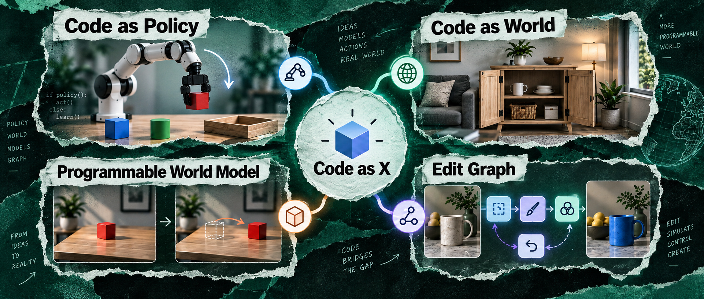

# Awesome Code as Policy/World/Editor

**Coding-agent papers that treat a program as the intermediate representation.**  

  

[English](README.md) | [中文](README.zh.md) | [HF Blog](https://huggingface.co/blog/kkakkkka/from-coding-agents-to-physical-agents) | [中文解读](https://mp.weixin.qq.com/s/MuOz0KmmQa5CxzjY7WEEvA) | [SourceMind](assets/sourcemind.jpg)

## Overview
- 🎯 [Aim](#aim)
- 📚 [Definitions](#definitions)
- 🦾 [Code as Policy](#code-as-policy)
- 🗺️ [Code as World](#code-as-world)
- 🧮 [Programmable World Models](#programmable-world-models)
- ✂️ [Edit Graph](#edit-graph)
- 📊 [Benchmark](#benchmark)
    - [Policy programs](#policy-programs)
    - [World programs](#world-programs)
    - [Robot evaluation infrastructure](#robot-evaluation-infrastructure)
- 📚 [Surveys and Lessons](#surveys-and-lessons)
- 🛠️ [Projects](#projects)
    - [Eval reports](#eval-reports)
    - [Policy programs in simulation](#policy-programs-in-simulation)
    - [Policy programs on a real robot](#policy-programs-on-a-real-robot)
    - [Plan, then call a VLA](#plan-then-call-a-vla)
    - [World programs from video](#world-programs-from-video)
    - [RL training stacks](#rl-training-stacks)
    - [Scene programs](#scene-programs)
- 🔗 [Related Resources](#related-resources)

## Aim
We collect papers where an agent writes or edits a program, a tool graph, or an explicit world state, then a simulator, renderer, robot, or editor runs it. That includes robot policies, executable scenes, programmable world models, image or video edit graphs, and benchmarks for those agents. Systems, evals, and case catalogs without a paper go under Projects, not under the paper sections.

New papers and projects get added as they appear. PRs are welcome.

## Definitions

- [Policy program](#def-policy-program)
- [World program](#def-world-program)
- [Programmable world model](#def-programmable-world-model)
- [Edit graph](#def-edit-graph)
- [Benchmark](#def-benchmark)
- [Project](#def-project)

**Policy program.** A Code-as-Policy agent is an LLM or VLM that writes executable robot programs, or a thin semantic action interface. That is the alternative to VLA action tokens. The name comes from Code as Policies.

- [⭐️] **Code as Policies**: Language Model Programs for Embodied Control.  

**World program.** A world program is an executable scene or physics program in Blender, MuJoCo, USD, CadQuery, or a similar stack. It is not a static mesh and not a video. Generation writes the program from language or a layout. Inversion / Reconstruction writes it from images, video, or scans.

- [⭐️] **SceneCode**: Executable World Programs for Editable Indoor Scenes with Articulated Objects.  

Physical Coding, from Self-Evolving Coding Agents: From Digital Programs to Physical-World Intelligence, also uses Code as World for symbolic robot task state: objects, relations, constraints, observations, and progress predicates. That is separate from the executable scene programs grouped below; see [Physical Coding / HexaAnything](#code-as-policy).  

**Programmable world model.** Programmable world models keep state and transitions in code. The generator or renderer only handles how things look.

- [⭐️] **Code World Model**: Coding Agent as World Brain.  

**Edit graph.** An edit graph is a sequence of tool calls, a visual program, or a timeline patch. You can inspect it and roll it back. VisProg is an early example.

- [⭐️] **VisProg**, Visual Programming: Compositional Visual Reasoning Without Training. 

**Benchmark.** These benchmarks test whether a coding agent can write, run, and revise a program. RLE-Bench is the policy side: robot learning, training stacks, and control. PhysCodeGym is the world side: reconstruct a video as an executable Blender program and check that the physics holds.

- [⭐️] **RLE-Bench**: A Qualifying Exam for Coding Agents as Robot Learning Engineers. 

- [⭐️] **PhysCodeGym**: Benchmarking Coding Agents for Physically Verifiable 4D Reconstruction.  

**Project.** A project here is an X post, Xiaohongshu post, webpage-only system, or eval whose primary artifact is not a paper. The coding agent still writes a program as the IR, or closed-loop controls a robot or simulator from code.

- [⭐️] **Awesome Astra Embodied AI**: GPT-6 Astra with embodied AI / robotics workflows and demos. 

## Code as Policy

- [⭐️] **Code as Policies**: Language Model Programs for Embodied Control.  

- [⭐️] **CaP-X**: A Framework for Benchmarking and Improving Coding Agents for Robot Manipulation.  

- [⭐️] **RATs**, Playful Agentic Robot Learning.  

- [⭐️] **Show-Harness**: Just a VLM Agent Can Play Robots.  

- **RACaP**, Agentic Reasoning, Acting, and Coding as Policies for Evolvable Robot Learning: evolves typed Policy APIs offline, then a runtime ReAct loop calls the frozen APIs. 

- **RoboDawn**, Transferring the Intelligence of VLMs to Robotic Control: gives the VLM a thin discrete command interface that grounds `move`, `rotate`, `gripper`, and related commands into motion.  

- **GPT-Policy**, In-Context Robot Learning with VLM Agents: compiles context for a VLM agent that issues robot-tool commands through a constrained controller.   

- **RoboDojo GPT-6 Astra evaluation**, An Unexpected Robot Policy: Early Evaluations of GPT-6 Astra on RoboDojo and Beyond: runs a VLM policy through the fixed RoboProbe harness on 42 simulation tasks and 2,100 trials; reports 28.97 average score and 22.48% average success, with real-robot testing halted for safety.  

- **SafeHarness**, Coding Agents with an Obstacle-Aware Harness for Safe Robot Manipulation: adds obstacle-aware routing and contact execution to reduce collisions in generated robot controllers. 

- **WetRobo**, A Reproducible Robot Kit for Coding Agents in Biological Laboratories: lets agents write and execute lab protocols while calling perception, planning, and simulation tools. 

- **AGP**, Agent as Policy for Robotic Manipulation: writes runtime programs, executes them, and revises the policy from physical feedback.  

- **PhysCaP**, Grounding Code-as-Policy Agent with Physics-Informed Exploration: adds information-seeking interactions to estimate hidden physical properties for robot manipulation.  

- **Agentic Push-T**, Revisiting the "Push-T" Robot Manipulation Task with Agentic Robotics: has a coding agent write the manipulation algorithm for Push-T without demonstrations. 

- **GaP**, A Graph-as-Policy Multi-Agent Self-Learning Harness for Variational Automation Tasks: represents policy as a directed perception-planning-control graph and refines it in simulation. 

- **ASPIRE**: Agentic /Skills Discovery for Robotics. Writes and repairs control programs from execution traces, then stores validated fixes in a reusable skill library.  

- **ENPIRE**: Agentic Robot Policy Self-Improvement in the Real World. Resets scenes, executes policies, verifies outcomes, and refines policy or training code from real-robot feedback.   

- **Physical Coding / HexaAnything**, Self-Evolving Coding Agents: From Digital Programs to Physical-World Intelligence: uses Code as World for symbolic task state and Code as Policy for execution; HexaAnything routes perception, planning, control, and VLA / WAM tools, verifies outcomes, and persists accepted traces as memory or training data.  

- **Harness VLA**: memory and visual feedback compose frozen VLA calls with analytic motion primitives.  

- **Recursive Harness Distillation**: Astra writes a playbook and revises it from Luna’s execution feedback, so the cheaper agent can guide a frozen VLA.  

- **RoboICL**: frozen GPT-6 Astra controls a robot from demonstration context and bounded interaction memory, without robot-specific finetuning or a learned VLA.   

- **SimEX**: a coding agent grows a toolbox of perception and action primitives in simulation, then writes a fresh code-as-policies script per instruction. Five real-robot trials adapt the toolbox and the simulator together.  

- **OpenRUA**: coding agents use native ROS 2 from the terminal, treat sensor readings as file I/O, and revise manipulation programs from execution feedback. 

- **URAI**, Make Code as Policy Great Again: a programming agent writes and revises reusable robot tools; an execution agent picks tools between complete local motions. 

- **EmbodiedSWE**: coding agents solve long-horizon dexterous tasks, then turn successful programs into simulation demonstrations for policy training. 

- **SpatialClaw**: a VLM writes iterative Python cells in a persistent kernel, mixing geometry tools with intermediate visual feedback. 

- **EmbodiedRSI**: picks informative trials, tests competing hypotheses, and revises executable code, skills, and memory around a frozen robot model. 

- **Recova**: a coding agent discovers recovery skills in a digital twin, then calls task and recovery policies with progress checks on the robot. 

- **PyRUA-Lean**: composes robot primitives and frozen VLA calls inside persistent Python cells, with local checks and retries. 

- **DynaHarness**: grounds runtime commands, monitors execution, and revises reusable robot programs only after regression checks. 

- **HarnessPAI**: runs a fixed task program over perception and action primitives, then edits that code between rollouts and keeps repair skills that pass. 

- **Eureka**: an LLM writes reward code from the environment source and task text, then revises it from RL returns. 

- **Code-as-Monitor**: generates visual monitoring code for spatio-temporal constraints, including checks that fire before a violation. 

- **ReKep**: turns language and RGB-D into Python constraint functions over 3D keypoints, then solves end-effector actions from those functions. 

- **COAP**, Embodied Turing Machines: improvement is a diff to stateful robot code. A shared library is written, tested, and debugged across rounds, then frozen and replayed. Reports 70.24% success on RoboDojo’s 42 bimanual tasks. 

- **AgenticGenTAMP**: coding agents synthesize one program per task-and-motion-planning environment; the frozen program then runs on held-out instances.  

- **PhysEvo**: keeps one model frozen and improves robot behavior from physical trials on RoboDojo and a real AgileX PiPER. 

- **VLCP**, Vision Language Control Policy: Closed-Loop Code Replanning for Robot Manipulation. 

- **RHO**, Your Coding Agent is Secretly a Roboticist. 

- **ALRM**, Agentic LLM for Robotic Manipulation.  

- **Act-Observe-Rewrite**, Multimodal Coding Agents as In-Context Policy Learners for Robot Manipulation. 

- **HyCodePolicy**, Hybrid Language Controllers for Multimodal Monitoring and Decision in Embodied Agents. 

- **ModuLoop**, Low-Level Code Generation using Modular Synthesizer and Closed-Loop Debugger for Robotic Control. 

- **NeSyRo**, Towards Reliable Code-as-Policies: A Neuro-Symbolic Framework for Embodied Task Planning. 

- **RoboPro**, Robotic Programmer: Video Instructed Policy Code Generation for Robotic Manipulation.  

- **ProgPrompt**: Generating Situated Robot Task Plans using Large Language Models. 

- **VoxPoser**: Composable 3D Value Maps for Robotic Manipulation with Language Models.  

- **Instruct2Act**: Mapping Multi-modality Instructions to Robotic Actions with Large Language Model. 

- **Language to Rewards** for Robotic Skill Synthesis. 

- **Demo2Code**: From Summarizing Demonstrations to Synthesizing Code via Extended Chain-of-Thought. 

- **Voyager**: An Open-Ended Embodied Agent with Large Language Models. 

- **AdaHVLA**: separate agents analyze evidence, revise a code harness, and judge behavior, keeping a graph of hypotheses and observed effects. 

- **RegenHarness**: proposes versioned edits to task templates, routing, and recovery rules, and only keeps a harness change after regression checks. 

- **Zetta**: freezes the base policy and grows runtime critics, recovery playbooks, and tools from failure diagnosis and held-out promotion.   

- **SHAPER**: with model weights frozen, target-environment rollouts evolve reusable skills and the context-code harness around them. 

- **VASO**: revises embodied skill contracts against temporal specifications and model-checking counterexamples.  

- **Code-as-Symbolic-Planner**: writes executable symbolic planning code from multimodal task context, then reuses those planning abstractions.  

- **Agentic Skill Discovery**: a language model writes tasks and reward code, RL trains the skill, and a visual check decides whether the skill enters a persistent library.  

- **RAX**: a coding agent explores a robot task, records successful preconditions, actions, and effects, then compiles a standalone Python controller that runs without the agent.  

- **ASENA**: connects a coding agent to robot sensing, supervised execution, and persistent experience. An optional learned navigation policy can be called as a tool. Model weights stay fixed while repeated tasks improve.  

## Code as World

### Generation

- [⭐️] **SceneCode**: Executable World Programs for Editable Indoor Scenes with Articulated Objects.  

- [⭐️] **VideoCoCo**: Code-as-CoT for Physically-Consistent Video Generation via an Agentic Dual-Engine System.  

- **Code Video Model**: writes a Three.js program as an executable previs, renders a proxy video and a reference image, then conditions a pretrained video model on the proxy only in early sampling steps. Code edits change layout, motion, and camera before the final clip.  

- **EmbodiedGen V2**: an agent builds and edits assets, multi-room scenes, and task environments, then exports URDF, USD, or MJCF after physics checks.  

- **SimFoundry**: a modular video-to-simulation pipeline that reconstructs objects, compiles a physical scene, and proposes tasks in OmniGibson.  

- **Procedura**: agentic 3D assemblies whose named parts are joined by typed, machine-checkable constraints. 

- **Articraft**: an agentic pipeline for scalable articulated 3D assets. 

- **HARMONY**: hierarchical agentic reasoning that turns one image into a scene program.  

- **AssemblyWorld**: general-purpose agents solve 3D assembly from rendered views and part records, not mesh vertices.  

- **USDCraft**: an LLM writes and revises a program that turns a mesh and a reference image into a simulation-ready articulated USD asset. 

- **AffordCraft**: from one photo and a task, builds task-ready simulation assets. 

- **Agentic RSR**: real-to-sim-to-real through scene reconstruction and execution-grounded robot policies. 

- **Artisan**: a multi-agent pipeline for physically grounded articulated 3D assets. 

- **Code-as-Room**: Generating 3D Rooms from Top-Down View Images via Agentic Code Synthesis.  

- **RoomWright**, Beyond Placement and Articulation: Usage-Driven Code Scenes for Embodied Interaction. 

- **SR-Platform**: An Agentic Pipeline for Natural Language-Driven Robot Simulation Environment Synthesis. 

- **GS-Agent**: Creating 4D Physical Worlds With Generative Simulation.  

- **SceneCraft**: An LLM Agent for Synthesizing 3D Scenes as Blender Code. 

- **3D-GPT**: Procedural 3D Modeling with Large Language Models. 

- **LL3M**: Large Language 3D Modelers. 

### Inversion / Reconstruction

- [⭐️] **NeoWorld-Pro**: Programming Interactive Scenes from Monocular Images for Embodied Simulation.  

- [⭐️] **Code as Worlds**: Agentic Discovery of Executable World Representations for Physical Reasoning.  

- [⭐️] **LiteReality-Agent**: An Agentic System for Interactable 3D Indoor Scene Reconstruction. 

- **VIGA**, Vision-as-Inverse-Graphics Agent via Interleaved Multimodal Reasoning.  

- **Thinking in Blender**: Staged Executable Inverse Graphics with Vision-Language Models. 

- **RCWM**, Recursive Code World Models: Building Complex Worlds through Recursive Scene Programs. 

- **VisPhyWorld**: Probing Physical Reasoning via Code-Driven Video Reconstruction.  

- **AstraLOD3**: multi-view evidence to an editable building reconstruction. 

- **RoboSimStudio**: humans and coding agents refine a Newton simulation's scene and physical parameters against observed robot behavior.   

## Programmable World Models

- [⭐️] **Code World Model**: Coding Agent as World Brain.  

- [⭐️] **Programmable World Model**.  

- **PoE-World**: Compositional World Modeling with Products of Programmatic Experts.  

- **PatchWorld**: Gradient-Free Optimization of Executable World Models for Agent Environments.  

- **Mind-Studio**: Executable World Models with Lookahead Evaluation for Partially Observable Games.  

- **CWM-GGP**, Code World Models for General Game Playing. 

- **Web World Models**.  

- **gWorld**, Generative Visual Code Mobile World Models.  

- **WorldCoder**: Building World Models by Writing Code and Interacting with the Environment. 

- **GIF-MCTS**, Generating Code World Models with Large Language Models Guided by Monte Carlo Tree Search. 

- **Baba in Wonderland**: discovers dynamics online and writes them down as an executable world model. 

- **Tycho**: builds programmatic world models by active abstraction for ARC-AGI-3.  

- **WALL-E**: learns rules that align a world model, then uses those rules for LLM-agent planning. 

- **WALL-E 2.0**: learns neurosymbolic rules so a world-model agent can adapt when the environment changes.  

- **VisualPredicator**: learns neuro-symbolic predicates as an abstract world model for robot planning. 

## Edit Graph

- [⭐️] **VisProg**, Visual Programming: Compositional Visual Reasoning Without Training. 

- [⭐️] **IEAP**, Image Editing As Programs with Diffusion Models.  

- [⭐️] **EditDuet**: A Multi-Agent System for Video Non-Linear Editing.  

- [⭐️] **VideoAgent**: All-in-One Framework for Video Understanding and Editing.  

- **CoSTA\***: Cost-Sensitive Toolpath Agent for Multi-turn Image Editing.  

- **FaSTA\***: Fast-Slow Toolpath Agent with Subroutine Mining for Efficient Multi-turn Image Editing.  

- **Lego-Edit**: A General Image Editing Framework with Model-Level Bricks and MLLM Builder.  

- **CanvasAgent**: Enabling Complex Image Creation and Editing via Visual Tool Orchestration.  

- **IMAGAgent**: Orchestrating Multi-Turn Image Editing via Constraint-Aware Planning and Reflection.  

- **RefineCut**, Plans You Can Check: Verifier-Grounded Learning of an Open-Weight Planner for Executable Video-Editing.  

## Benchmark

### Policy programs

The agent writes, runs, or revises a robot control or learning program.

- [⭐️] **RLE-Bench**: A Qualifying Exam for Coding Agents as Robot Learning Engineers. 

- **CodeActionBench**: 25 simulated dual-arm tasks where the agent writes, runs, and revises code against a robot API with RGB and calibrated geometry, without depth or privileged state. 

- **LIBERO-Agent**: general-purpose agents choose observations and issue native robot commands; the split is perception, short-horizon execution, and long-horizon manipulation.  

- **RoboQuest**: general-purpose agents issue robot commands through tool calls on ten simulated kitchen mobile-manipulation tasks, searching, inspecting, or testing to find hidden information before pressing SUBMIT. Astra leads five frontier agents (23.2% success).   

- **AA-Robotics v0.1**: eight tabletop tasks on a real Hiwonder NexArm. A coding agent in an isolated container drives the arm through an HTTP API and four cameras, and a person scores the end state. GPT-6 Astra scores 69.4, first of five. 

### World programs

The agent writes an executable scene, CAD model, or physics program. A renderer or simulator then runs it.

- [⭐️] **PhysCodeGym**: 156 tasks where a coding agent reconstructs a reference video as an executable Blender program. Scoring covers the rendered video and the scene's physical behavior, including counterfactual interventions. With Codex, GPT-6 Astra leads overall at 0.663.  

- **4DCodeBench**: agents write executable code that reconstructs dynamic scenes from 200 videos. Astra Max leads 18 agents (overall 0.79) and leads dynamics by 31%.  

- **Video2World**: 222 tasks from 189 embodied videos; coding agents rebuild interactive simulated worlds. Astra ranks 2nd of 9 (V2WScore 43.55, 10.7% success) with the most accurate geometry, still far below the human-assisted reference.  

- **BVB**: the agent rebuilds each video as a Blender program, then answers spatiotemporal questions on that program. Astra high scores overall 70.07, rank 1 of 51 on the paper's frontier set. On the live leaderboard of 63 configurations (2026-10-14), Astra xhigh is 73.82, rank 1. 

- **WorldCoder-Bench**: Evaluating Executable Three.js Worlds. 

- **CodeVideoBench**: 22 editable Three.js cases for controllable video, covering gaming, scene editing, physics, and 3D/4D reconstruction. With MiniMax-H3, Code Video Model reports overall scores of 85.2 / 82.1 / 85.8 under QwenVL-3.8-27B, GPT-5.6, and GPT-6, versus 74.3 / 73.1 / 80.6 for VACE.  

- **3JSBench**: 100 short text-to-Three.js tasks, with the generation requests and inspectable geometry. 

- **BenchCAD**: multi-view renders to CadQuery, scored by mean voxel IoU. With tools, Astra is reported at 95.9%. 

- **Moonlake 3D Agent**: sim-ready asset benchmark across 22 metrics and Isaac Sim interaction tests; reported rank score 65.2 versus Astra 47.0. 

- **BuildingBench**: a coding agent turns four photographs of a public building into one textured glTF. On the 2026-10-14 leaderboard, Codex CLI at ultra effort scores 0.843 ± 0.014, third of 32. Claude Opus 5.5 (max) leads at 0.868.  

- **threejseval**: 16 fixed Three.js scene prompts. People vote between unlabeled scenes. Astra at medium effort is Elo 1884 ± 105, rank 4 of 36. Claude Opus 5.5 High leads at 2071. 

- **MineBench**: the model writes JavaScript against a small voxel API (`block`, `box`, `line`), then people vote. Astra Pro is 2259 ± 16.7, rank 2 of 74. Gemini 4 Argon leads at 2269, and the two intervals overlap. The author does not call it a benchmark.  

### Robot evaluation infrastructure

These evaluate robot policies broadly, including learned policies and program or command interfaces. They are policy-evaluation infrastructure, not code-generation benchmarks.

- **XPolicyLab**: A Unified Standard and Open Ecosystem for Robot Policy Evaluation and Deployment.  

- **RoboDojo**: A Unified Sim-and-Real Benchmark for Comprehensive Evaluation of Generalist Robot Manipulation Policies.  

- **HumanCLAW**: Can Vision-Language Models Act Through a Body? Tests VLM decisions through a harness that turns them into humanoid motion-generator calls. 

- **Robo Use Leaderboard**: aggregates published solve rates for agent harnesses and VLA policies, with 95% Wilson intervals. Each task counts once per model and harness. 

## Surveys and Lessons

- **World Models for Embodied Intelligence: From Plausible to Controllable to Actionable**: surveys embodied world models by predictive plausibility, intervention controllability, and downstream decision utility. Useful context for executable and programmable world models. It does not require code as the intermediate representation. 

- **Robot-Use Agents** (Phillip Isola): perspective on general-purpose agents that use robots through sensor and actuator APIs. 

- **Goosebumps** (Ken Goldberg): argues that coding agents can write, test, and revise modular robot programs offline, between model-based engineering and robot learning. 

- **Survey on Multimodal Embodied Agents**: unifies computer-use and robot-use as perceive, anticipate, plan, act, and verify. Broader than code-as-IR methods.  

- **Weights or Skills?** A Survey of Robot-Learning Techniques: from Action-Predicting Weights to Robots that Write their Own Skills: frames the split between frozen action-predicting weights and executable robot skills. 

- **Code as Agent Harness**: surveys executable, verifiable, stateful harness design for agents that write and run code. 

- **What Stops Recursive Self-Improvement in Robotics?** Lessons from 123 Rounds of Agentic Skill Discovery: reports an agent that wrote, installed, and tested skills, but never solved the target fridge task; relational perception, early-skill bottlenecks, and evaluator behavior were the main failure points. 

- **Harness Engineering for Physical AI**: argues that robot middleware should be the harness: it projects, isolates, and transfers control, compute, and communication around a model. 

- **Agentic World Modeling**: a survey of agentic world models, their capabilities, and the laws proposed for them. It is broader than code-as-IR methods. 

- **Towards Agentic Robots: Model, Data, Environment, and Harness**: organizes agentic-robot research into those four domains. Broader than code-as-IR methods; harness is one of the four.  

## Projects

X posts, Xiaohongshu posts, and webpage-only systems. Papers stay in the sections above. Case catalog: [Awesome Astra Embodied AI](https://github.com/zjwzcx/Awesome-Astra-Embodied-AI).

- [⭐️] **Awesome Astra Embodied AI**: GPT-6 Astra case catalog for embodied workflows. 

- **GPT-6 Astra** (OpenAI): coding agent used here as a robot policy, world programmer, and RL environment engineer. 

### Eval reports

- **GPT-as-Policy**, Galbot: public benchmark and report that scores GPT-6 Astra as an embodied policy. 

- **RoboCurve GPT-6 Astra evaluation**: controlled YAM-arm study; reports 19/20 bowl-task completions and 80% fewer output tokens. 

- **RPent** (RLinf): recursive harness that pairs an agentic planner with frozen VLA primitives. The leaderboard reports GPT-6 Astra at 92.63% overall on LIBERO-PRO (741/800) and 59.20% on RoboCasa365 Target50. 

- **Astra on RoboMME**: three-tier controller on 16 RoboMME tasks; reports 79.13% success (633/800) with 3.63 Astra planning calls per episode. A fine-tuned π0.5 runs the subtask, and a Qwen3-VL-4B monitor decides when Astra should replan.  

- **RoboICL**: frozen Astra on 30 RoboDojo tasks; reports overall progress 50.64, zero-shot on Open and one demonstration elsewhere, plus three real-robot tasks. See also [RoboICL](#code-as-policy).  

### Policy programs in simulation

- **UR10 conveyor sorting** (NVIDIA Omniverse): Astra builds a conveyor and inspection scene in VS Code, then wires a UR10 and Robotiq gripper to sort rejects. 

- **G1 stage burpee**: a scripted Unitree G1 routine in public code: carry a stand on stage, hold a pose, do push-ups, then jump. 

- **Dual-ALOHA Spatial-constraint Puzzles** ([Qineng Wang](https://x.com/qineng_wang)): plans Dual-ALOHA motions that unhook interlocked parts and thread a rope through three rings.  

- **Vision-only Humanoid Body Control** ([ZQ](https://www.rednote.com/user/profile/5f20ee17000000000101c247)): controls a simulated humanoid from camera observations only, with no privileged simulator state. 

- **G1 Cola Bottle Pick-up in Isaac Sim** ([Flood Sung](https://x.com/RotekSong)): high-level plan for a Unitree G1 cola pick-up; GEAR-SONIC tracks the whole-body qpos. 

- **Quadruped Five-key-joint Trajectory** ([Akira Sasaki](https://x.com/gclue_akira)): outputs a sparse five-joint trajectory; a low-level controller runs the quadruped in MuJoCo. 

- **G1 Navigation Tracked by SONIC** ([Flood Sung](https://x.com/RotekSong)): navigation plan for a simulated G1; GEAR-SONIC converts it into a whole-body trajectory. 

- **Robot Hands Solve a Rubik’s Cube** ([Ze Yanjie](https://x.com/ZeYanjie)): zero-shot dexterous cube solving in simulation. 

- **Dexterous Apple-stem Grasp in SuperDex** ([Kiki Huang](https://www.rednote.com/user/profile/62f72244000000001f0176ea)): dexterous hand grasps the narrow stem of an apple in SuperDex / MuJoCo. 

- **HumanCLAW-Bench** ([Jiawei Gu](https://x.com/Kuvvius)): completes benchmark navigation and interaction tasks through the HumanCLAW-Bench harness. 

- **Whole-body Trajectory + Controller** ([橘子不是唯一的水果](https://www.rednote.com/user/profile/695bb2a2000000003702ea8f)): writes a whole-body trajectory; a whole-body controller closes the loop. 

- **Isaac Sim Cube Grasp from One Prompt** ([神秘小孙](https://www.rednote.com/user/profile/5b3f9fc86b58b75d4c02ccc0)): one task sentence builds a depth-camera cube-grasp demo in Isaac Sim. 

- **Physically Writing a Fibonacci Sequence** ([Dmytro Hrybov](https://x.com/dimentary)): long-horizon G1 Fibonacci-writing task in simulation, ending in generated code and motion. 

- **LLM Harness for Tabletop Robot Control** ([Jiafei Duan](https://x.com/DJiafei)): writes and runs the control loop for a simulated tabletop grasp-and-place task. 

### Policy programs on a real robot

- **Agent as Policy on a real YAM**: GPT-6 Astra in Codex writes and runs programs on a real arm, then revises them from camera feedback. Tasks include assembly from a human video, block building from a goal image, dice reorientation, throwing, and bimanual towel folding. See also [AGP](#code-as-policy).  

- **Learning to Type on a Keyboard** ([Kaifeng Zhang](https://x.com/kaiwynd)): turns an open-ended “express yourself” prompt into real key presses with about 40 minutes of visual feedback. 

- **Marker Grasp from Low-level Control Only** ([star大小变](https://www.rednote.com/user/profile/69c2311e000000003203e786)): discovers joint-to-end-effector control and grasps a marker in about 30 minutes, with no prior skills. 

- **Mobile Manipulation with In-context Learning** ([Axel](https://x.com/ax_pey)): infers mobile-manipulation behavior from visual context across rooms and layouts, without a task-specific text prompt. 

- **Rapid Adaptation to an Unseen Embodiment** ([Lucas Cassiano](https://x.com/lucascassiano)): learns a new robot and [Vitrus AI](https://x.com/Vitrus_ai) control interface online, without human egocentric data or a VLA. 

- **ENPIRE Robotics Harness In-context Learning** ([Tonghe Zhang](https://x.com/TongheZhang01)): in-context robot learning through the ENPIRE harness, without task-specific retraining. 

- **Cucumber Slicing with Loop-ROS** ([盒子桥](https://www.rednote.com/user/profile/65bb8b3d000000000d03e137)): directly controls a real arm through Loop-ROS for a cucumber-slicing sequence. 

- **Painting the Golden Gate Bridge** ([thijs](https://x.com/cdngdev)): given a robot, a paintbrush, and a camera, turns a semantic prompt into real brush strokes and improves across attempts. 

- **Direct End-effector Pose Control** ([Loule](https://www.rednote.com/user/profile/69ddd8920000000033024ad0)): outputs end-effector poses to put the longest piece of bread into a basket, using third-person and wrist cameras. 

- **Piper Carrot Pick-and-place** ([虽然不但是](https://www.rednote.com/user/profile/5f5ca72900000000010061fb)): Codex / GPT-6 plus Piper and RealSense; repeated visual pick-and-place of a carrot. 

- **SimEX on a dual-arm YAM**: after sim autoresearch, about ten minutes of real-robot time per task covers barcode scanning, plate-to-tote, and towel folding. See also [SimEX](#code-as-policy). 

- **Mocap whip and lasso** ([Krishna Suresh](https://krishnasuresh.org/blog/2026/robot-whips/)): one prompt builds IK, dynamics-constrained trajectory optimization, and an inverse-dynamics controller so an OpenarmX and an xArm7 replay whip cracking and cleat lassoing open-loop. 

### Plan, then call a VLA

- **Harness VLA / RPent**: Astra plans with memory and visual feedback, then calls a frozen VLA plus a fixed library of analytic motion primitives. The real-robot demo sorts plates and retries a failed grasp without fine-tuning the VLA. See also [Harness VLA](#code-as-policy).  

- **Recursive Harness Distillation**: Astra distills robot problem solving into a playbook and revises it from Luna’s feedback, so Luna can steer a frozen VLA. See also [Recursive Harness Distillation](#code-as-policy). 

- **Astra on RoboMME**: Astra plans subtasks from instructions and visual history; a fine-tuned π0.5 executes them, and a fine-tuned Qwen3-VL-4B says when the subtask is done.  

- **Zero-shot Task Execution through FluxVLA** ([Jikun](https://www.rednote.com/user/profile/5e25bcdc00000000010085a8)): Astra does task inference and planning; pretrained [FluxVLA](https://github.com/FluxVLA/FluxVLA) runs the low-level actions. 

### World programs from video

- **Astra for 4D Shape Fitting** ([Edgar Sucar](https://x.com/SucarEdgar)): fits a 4D shape from video, using a human tip that leaves are symmetric to constrain the fit. Takes hours and back-and-forth prompting. 

- **Guan’s Fencing Club**: match video, two animated fencers, and a procedural hall on a UE5 timeline, with a one-second sword-tip trail. 

- **AHa-3D**: Astra plus reconstruction tools turn indoor video into editable Blender rooms, recover human motion with contact refinement, and export a browser scene.  

- **Real2Gym**: an agent rebuilds a Blender / MuJoCo gym from video, then runs generated Python stages with visual feedback before skill transfer. 

- **Lab Kitchen Reconstruction** ([Frank ZY Dou](https://www.rednote.com/user/profile/5e3431cf0000000001002919)): rebuilds a lab kitchen with articulated cabinets from a 20-second monocular RGB video. 

- **Rope-driven Dexterous Hand Reconstruction** ([Dmytro Hrybov](https://x.com/dimentary)): recreates 1X’s tendon-driven hand demo in MuJoCo, with simplified tendon mechanics. 

- **Tendon-driven Dexterous Hand Motion Reconstruction** ([Jake Fitzgerald](https://x.com/earthtojake)): designs a tendon-driven hand and reconstructs cable-actuated finger motion in simulation. 

- **Dexterous Hand-object Data Rollout** ([Lingxiao](https://x.com/Lingxiao234)): two videos drive real-to-sim reconstruction and physical retargeting onto Wuji hands, without explicit states or actions. 

- **Video in → Physics out** ([xiao hu](https://x.com/huxiao93612565)): writes hand tracking, IK retargeting, and grasp-refinement code for a 44-DoF hand. 

- **Multi-view Real-to-sim Reconstruction** ([Lingxiao](https://x.com/Lingxiao234)): builds a replayable MuJoCo / Blender simulator from multi-view RGB, robot actions, calibration, assets, and system identification. 

- **Robotica Real2Sim**: a table photo becomes a MuJoCo scene with a Franka Panda. Codex records 50 inverse-kinematics episodes, then a plan is replayed under physics variations. 

### RL training stacks

- **Dexterous Astra** ([Jianglong Ye](https://github.com/jianglongye)): released artifacts from Astra experiments, not a harness given to the agent. Sharpa Wave pen spinning in Isaac Lab (a zero-shot keyframe planner, then PPO for three turns and a hold) and Wuji-hand Rubik's cube in MuJoCo (a zero-shot two-hand script, then a learned one-hand policy that solves `U F L`). 

- **Office Real2Sim2Real Cart Push** ([watchtower](https://www.rednote.com/user/profile/5e38ca4e00000000010034fa)): rebuilds an office, estimates contact supervision, trains an RL cart-push policy with SONIC for whole-body motion, then deploys it on the real humanoid. 

- **Sharpa Hand Pen-spinning RL** ([Wentao Zhu](https://x.com/walterzhu8) / Chengyang Li): autonomous ~1.5-day run that builds the pen mesh, an Isaac Lab Sharpa-hand task, a PPO policy, and a visualization video. 

- **RL-trained Duck Robot** ([拂晓时分_茉莉飘香](https://www.rednote.com/user/profile/5ffbc96d00000000010060ae)): one image and one description become an RL-trained duck locomotion demo. 

- **Quadruped Locomotion from RL** ([Akira Sasaki](https://x.com/gclue_akira)): co-designs a robot dog, iterates 25 loops in five days, and trains nine simulated motions with RL. 

- **Dexterous In-hand Manipulation RL** ([十一](https://www.rednote.com/user/profile/610bc8f100000000200284e2)): trains in-hand walnut manipulation; the reported run did not enable self-collision. 

- **Office Scan → Newton / G1 Gym** ([Jiarui Xu](https://x.com/Jiarui_X)): rebuilds an office scan in Blender, exports USD, and makes a G1 walking scene in Newton. 

- **Isaac Sim Environment, PPO Training, and Tuning** ([十一](https://www.rednote.com/user/profile/610bc8f100000000200284e2)): builds an Isaac Sim RL environment, configures PPO, and iterates the run in one workflow. 

### Scene programs

Astra writes a scene, CAD model, or playable world as code, then Blender, OpenSCAD, Three.js, or a game engine runs it. The full set is 338 examples in [Awesome Astra 3D](https://github.com/carpentry-liu/awesome-astra-3d) ([gallery](https://carpentry-liu.github.io/awesome-astra-3d/)). Entries below are source-backed starting points, grouped by the program that gets executed. Video-only renders stay in that atlas.

- [⭐️] **Awesome Astra 3D**: Blender, Houdini, Three.js, CAD, VRM, and interactive-game case catalog.  

#### Executable scenes

- **Solace**: architectural iteration through Blender, Cycles, and UE5. 

- **Pelican on a bicycle**: three Blender iterations with editable meshes and recorded conversations. 

- **GPTBlender floor plan**: turns a floor plan into a downloadable furnished home.  

- **Realsee**: scan to an editable Blender space, with roaming video and prompts. 

- **Orbital Core**: Blender and GLB assets inside an interactive Three.js page. 

- **Piața Unirii**: same brief, voxel square, prompt and source kept. 

- **Real2Sim rooms**: photos to editable rooms, with failed reconstructions kept in the repo. 

- **Jetis**: DWG factory walkthrough exported as a native SketchUp model. 

- **WorldGen**: three text scenes built in Blender and Unity. 

- **Junya city generator**: JSON road networks become an editable Blender scene, then Unreal renders. 

- **Renders**: four Blender architecture projects with revision scripts and an archive of older cuts. 

- **Stanford in Blender**: five editable campus scenes, with procedural scripts and standalone `.blend` files. 

- **Gulou campus**: a walkable Nanjing University campus in TypeScript, Three.js, and Rapier, with cycling, gliding, and weather. 

- **Gargantua**: a shader accretion disk and bent light, with an orbit camera. 

- **BHBench**: Astra’s native black-hole renderer, with the generated C++ / GLSL, ray integration, and a curvature grid. 

- **One Equation, Three Worlds**: one Lorenz curve kept as an editable copper sculpture, procedural ink, and moving light. 

#### CAD programs

- **J-hook**: OpenSCAD print design compared across models; strength testing still pending. 

- **Villa, recursive film, turbine CAD**: three editable 3D projects in one repo. 

- **Realitizer**: Swift code-first models of a manta ray and a house. 

- **Aetheris difference engine**: hierarchical CAD of digit wheels, carry gears, and a crank, with STEP export. 

- **LDraw Nova**: Python generators emit editable LDraw cathedrals and a tidal observatory. 

- **DeepSeek whale**: a logo silhouette becomes an editable single-solid desktop print mesh. 

#### Playable world programs

- **Living Deep**: extends an existing ocean simulation with underwater ecology. 

- **Smash Karts**: multiplayer client, server, and a public agent trajectory. 

- **Little Flock**: one-shot pasture world, with the goal prompt in the repo. 

- **Windfield**: 3D adventure plus a terrain editor. 

- **Melon Jelly**: WebGPU soft-body comparison. 

- **Pelagic**: procedural ocean and sailboat exploration. 

- **H3 Battle Lab**: 3D units wired to native VCMI combat. 

- **Seabright**: Unity coastal city builder with roads, services, and taxes. 

- **Octane Arena**: procedural 3D car soccer with source for the physics. 

- **Astra Air Combat**: seeded arenas and a 60 Hz dogfight loop. 

- **Palm Bay**: a preserved one-shot low-poly driving sandbox, with the original prompt and recovered JavaScript. 

- **Corner Mart**: an editable convenience store with shopping lists and a three-minute shift, plus the `.blend`, GLB, and generation scripts. 

- **Hallowmere**: a torchlit village RPG with procedural characters, combat, and co-op. 

- **Morrow**: an interactive moonlit plush ghost in one HTML file, with grab, poke, brush, and color controls. 

- **Moss & Moon**: a procedural fox and woodland ecosystem in Three.js, with a skeleton, foot IK, and need-driven pathfinding. The Astra submission is kept in its own folder. 

## Related Resources

- **Awesome Physical AI**: broader curated reading list for robot-policy VLMs, coding agents, policy harnesses, and RoboDojo-style scorecards. 

- **Awesome Robot Use Agent**: catalog of robot-use agents, harnesses, ROS tool stacks, and social demos. Entries here keep only the ones that use a program as the intermediate representation.  

- **Awesome AI for 3D Modeling & Robotics**: source-linked cases for AI 3D modeling, CAD, and robot control, plus benchmark numbers read from the original reports. Social clips stay in that catalog.  

- **Awesome Multimodal Embodied Agent**: computer-use and robot-use agents, from surveys through benchmarks. 

- **Awesome Embodied RSI**: embodied recursive self-improvement, grouped by what gets updated: model, memory, skills, or harness. 

- **Awesome Humanoid Robot Learning**: humanoid locomotion, manipulation, teleoperation, and sim-to-real. Most entries are learned policies, not programs. 

- **Awesome Embodied Robotics and Agent**: embodied robotics methods and benchmarks. 

- **Awesome Agentic Robotics**: agent, harness, and VLA stacks for robot control. 

- **Awesome Agentic World Modeling**: world models sorted into predictor, simulator, and evolver. 
